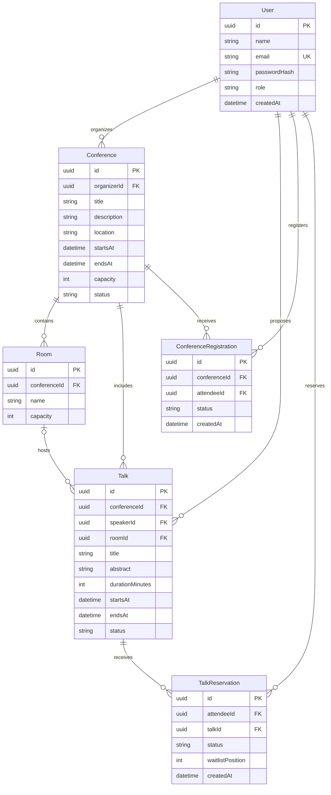

# EventPro – podatkovni model

## Podatkovna baza

Za shranjevanje podatkov bomo uporabili relacijsko podatkovno bazo **PostgreSQL**. Vsaka entiteta ima enolični identifikator (`id`) tipa UUID. Datume in ure shranjujemo skupaj s časovnim pasom.

## Entitete in glavna polja

| Entiteta | Namen | Glavna polja |
|---|---|---|
| **User** | Uporabniki aplikacije. | `id` (PK), `name`, `email` (UNIQUE), `passwordHash`, `role`, `createdAt` |
| **Conference** | Dogodki in njihove osnovne informacije. | `id` (PK), `organizerId` (FK), `title`, `description`, `location`, `startsAt`, `endsAt`, `capacity`, `status` |
| **Room** | Prostori za predavanja. | `id` (PK), `conferenceId` (FK), `name`, `capacity` |
| **Talk** | Predlogi in potrjena predavanja. | `id` (PK), `conferenceId` (FK), `speakerId` (FK), `roomId` (FK, lahko prazno), `title`, `abstract`, `durationMinutes`, `startsAt`, `endsAt`, `status` |
| **ConferenceRegistration** | Prijave udeležencev na dogodke. | `id` (PK), `conferenceId` (FK), `attendeeId` (FK), `status`, `createdAt` |
| **TalkReservation** | Rezervacije predavanj in čakalni seznam. | `id` (PK), `talkId` (FK), `attendeeId` (FK), `status`, `waitlistPosition` (lahko prazno), `createdAt` |

**PK** označuje primarni ključ, **FK** pa povezavo z drugo tabelo.

### Možne vrednosti statusov

- `User.role`: `ORGANIZER`, `SPEAKER`, `ATTENDEE`.
- `Conference.status`: `DRAFT`, `PUBLISHED`, `ARCHIVED`.
- `Talk.status`: `SUBMITTED`, `ACCEPTED`, `REJECTED`, `SCHEDULED`.
- `ConferenceRegistration.status`: `ACTIVE`, `CANCELLED`.
- `TalkReservation.status`: `CONFIRMED`, `WAITLISTED`, `CANCELLED`.

Predavanje še nima prostora in termina, dokler ga organizator ne razporedi. Zato so polja `roomId`, `startsAt` in `endsAt` lahko prazna. Polje `waitlistPosition` je izpolnjeno samo za udeležence na čakalnem seznamu.

## Povezave med entitetami

- En organizator lahko ustvari več dogodkov. Vsak dogodek ima enega organizatorja.
- En dogodek ima lahko več prostorov in predavanj.
- En predavatelj lahko predlaga več predavanj. Vsako predavanje ima enega predavatelja.
- En prostor lahko gosti več predavanj ob različnih urah. Predavanje ima največ en prostor.
- En udeleženec se lahko prijavi na več dogodkov in rezervira več predavanj.
- Vsaka prijava pripada enemu dogodku in enemu udeležencu.
- Vsaka rezervacija pripada enemu predavanju in enemu udeležencu.

## Pravila in omejitve

1. Vsak uporabnik ima eno vlogo. Organizator lahko ureja samo svoje dogodke.
2. Udeleženec se lahko na isti dogodek prijavi samo enkrat. Kombinacija `conferenceId` in `attendeeId` mora biti enolična.
3. Udeleženec ima na posameznem predavanju samo en zapis. Kombinacija `talkId` in `attendeeId` mora biti enolična.
4. Število aktivnih prijav ne sme preseči kapacitete dogodka.
5. Število potrjenih rezervacij ne sme preseči kapacitete prostora, v katerem poteka predavanje.
6. Dve predavanji ne smeta potekati istočasno v istem prostoru. Predavatelj prav tako ne sme imeti dveh predavanj ob istem času.
7. Predavanje in njegov prostor morata pripadati istemu dogodku.
8. Rezervacijo lahko ustvari samo udeleženec z aktivno prijavo na dogodek. Potrjena rezervacija ne sme časovno sovpadati z drugo njegovo potrjeno rezervacijo.
9. Če ni prostih mest, se udeleženec lahko uvrsti na čakalni seznam. Rezervacija dobi status `WAITLISTED` in položaj v vrsti.
10. Ob odpovedi potrjene rezervacije sistem preveri čakajoče po vrstnem redu. Mesto dodeli prvemu, ki ima še aktivno prijavo in nima časovnega konflikta. Ostali ohranijo položaj na čakalnem seznamu.
11. Ob odpovedi prijave na dogodek se odpovejo tudi pripadajoče rezervacije in vpisi na čakalne sezname.
12. Odpovedano rezervacijo lahko uporabnik ponovno aktivira samo po ponovnem preverjanju pogojev.

Preverjanje kapacitete in shranjevanje rezervacije potekata v eni podatkovni transakciji, da sočasne prijave ne presežejo števila mest.

## Osnutek ER-diagrama

## Možnost nadaljnjega razvoja

Podatkovni model lahko kasneje razširimo z obvestili, QR-kodami, potrdili o udeležbi in plačili. Za to lahko dodamo nove entitete brez večjih sprememb obstoječih tabel.
