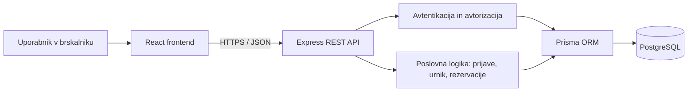

# EventPro – arhitektura in tehnološki sklad

## Glavni deli sistema
- **Frontend:** React aplikacija za organizatorje, predavatelje in udeležence.
- **Backend:** Node.js in Express REST API, ki izvaja poslovna pravila, avtorizacijo in validacijo.
- **Podatkovna baza:** PostgreSQL za uporabnike, konference, predavanja, prijave in rezervacije.
- **ORM:** Prisma za podatkovni model, migracije in dostop do baze.

## Komunikacija med deli
Brskalnik pošilja HTTPS zahteve v obliki JSON na REST API (`/api/...`). Strežnik preveri prijavo in pravice uporabnika, izvede domensko logiko ter s Prisma dostopa do PostgreSQL. Odgovor vrne v JSON; frontend posodobi prikaz. Brskalnik nima neposrednega dostopa do baze.

## Diagram arhitekture



## Avtentikacija in upravljanje uporabnikov
Uporabnik se registrira z e-pošto in geslom; geslo se shrani izključno kot varna zgoščena vrednost (Argon2id). Ob prijavi strežnik vzpostavi sejo s piškotkom `HttpOnly`, `Secure` v produkciji in `SameSite=Lax`. Na backendu se za vsako zaščiteno operacijo preveri uporabnikova vloga in lastništvo podatkov. Organizator ne more spreminjati tujih konferenc; predavatelj ne more potrjevati svojih predlogov; udeleženec lahko upravlja le svoje rezervacije. API izvaja validacijo vhodnih podatkov.

## Tehnološki sklad

| Področje | Tehnologija |
|---|---|
| Frontend | React, Vite, TypeScript, CSS |
| Backend | Node.js, Express, TypeScript |
| Podatkovna baza | PostgreSQL |
| ORM in migracije | Prisma |
| Avtentikacija | Strežniške seje, varni piškotki, Argon2id |
| Validacija | Zod |
| Lokalni razvoj | VS Code, Git, GitHub, npm, Docker Compose za PostgreSQL |
| Preizkušanje | Vitest, Supertest |

## Primeri API poti
- `POST /api/auth/register`, `POST /api/auth/login`, `POST /api/auth/logout`
- `GET /api/conferences`, `POST /api/conferences`
- `POST /api/conferences/:id/talks` – oddaja predloga
- `PATCH /api/talks/:id/decision` – odločitev organizatorja
- `PATCH /api/talks/:id/schedule` – dodelitev termina in prostora
- `POST /api/conferences/:id/registrations` – prijava na konferenco
- `POST /api/talks/:id/reservations` – rezervacija ali čakalni seznam
- `DELETE /api/talks/:id/reservations/me` – odpoved rezervacije
- `GET /api/me/schedule` – osebni urnik

## Lokalni zagon
1. Namestimo Node.js, npm in Docker Desktop.
2. Kloniramo repozitorij in v korenu izvedemo `npm install` v mapah `frontend` in `backend`.
3. Z `docker compose up -d` zaženemo lokalni PostgreSQL.
4. V `backend/.env` nastavimo `DATABASE_URL` in skrivnost za seje; `.env` ni del repozitorija.
5. V mapi `backend` izvedemo `npx prisma migrate dev` in `npm run dev`.
6. V mapi `frontend` izvedemo `npm run dev`; aplikacijo odpremo na naslovu, ki ga izpiše Vite (običajno `http://localhost:5173`).
7. Razvojni frontend prek Vite proxyja usmerja `/api` na backend (običajno `http://localhost:3001`).

## Utemeljitev arhitekturnih odločitev
- **React + TypeScript:** komponentni uporabniški vmesnik in preverjanje tipov pri razvoju.
- **Express REST API:** jasna ločitev uporabniškega vmesnika od poslovne logike in možnost prihodnjih odjemalcev.
- **PostgreSQL:** relacije, enolične omejitve in transakcije so pomembne za prijave in rezervacije.
- **Prisma:** pregledna shema in ponovljive migracije.
- **Strežniške seje:** omogočajo preklic prijave na strežniku in preprečijo hranjenje avtentikacijskih žetonov v `localStorage`.
- **Transakcije za rezervacije:** preprečijo dvojno dodelitev zadnjega prostega mesta ob sočasnih zahtevah.
- **Docker Compose:** enotna lokalna baza za vse razvijalce brez ročne namestitve PostgreSQL.

## Predlagana struktura repozitorija

```text
eventpro/
├── frontend/
├── backend/
│   └── prisma/
├── docs/
│   ├── 01-zasnova-resitve.md
│   ├── 02-funkcionalnosti-in-obseg.md
│   ├── 03-podatkovni-model.md
│   └── 04-arhitektura-in-tehnoloski-sklad.md
└── docker-compose.yml
```
