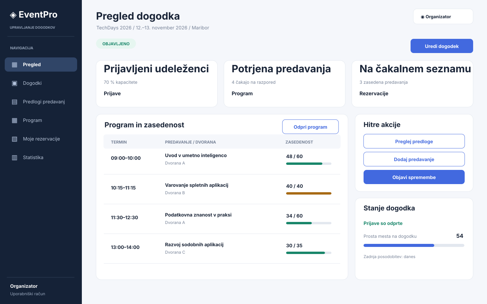
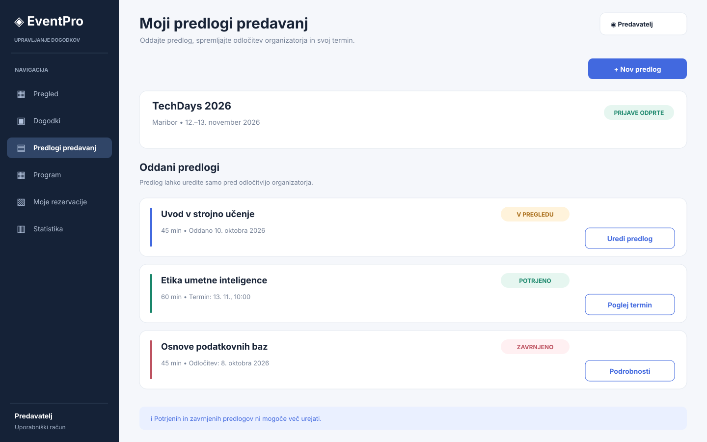
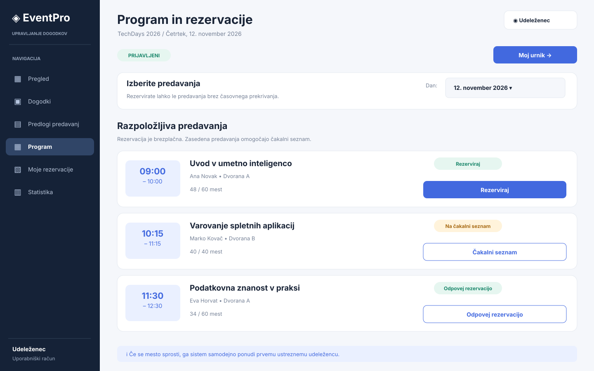
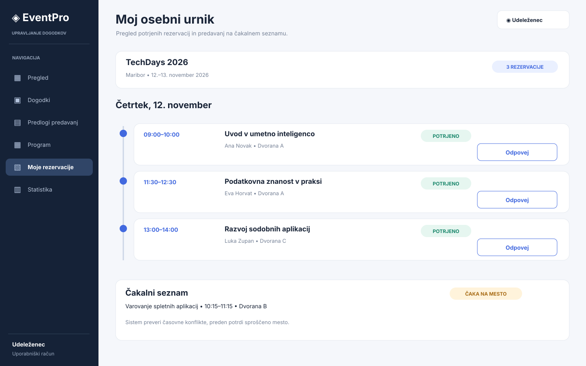

# EventPro – wireframes

Dokument prikazuje štiri osnovne zaslonske osnutke (*wireframes*) aplikacije EventPro. Gre za shematske prikaze uporabniškega vmesnika, ne za končni vizualni dizajn. Vsi prikazani podatki so primeri.

## 1. Pregled dogodka – organizator

**Povezane zgodbe:** US-01, US-03, US-07. Organizator vidi svoj dogodek, število prijav, število potrjenih predavanj in stanje čakalnih seznamov. V tabeli pregleda program, dvorane in zasedenost predavanj ter odpre urejanje dogodka.

## 2. Predlogi predavanj – predavatelj

**Povezana zgodba:** US-02. Predavatelj vidi seznam svojih predlogov in njihove statuse. Lahko odda nov predlog, predlog s statusom ODDANO pa lahko tudi uredi. Potrjenih in zavrnjenih predlogov ne more več spreminjati.

## 3. Program in rezervacije – udeleženec

**Povezane zgodbe:** US-04, US-05, US-06. Udeleženec vidi program dogodka in status svoje prijave. Pri prostih predavanjih lahko rezervira mesto, pri zasedenih se lahko pridruži čakalnemu seznamu, obstoječo rezervacijo pa lahko odpove. Sistem pred potrditvijo preveri kapaciteto in časovne konflikte.

## 4. Osebni urnik – udeleženec

**Povezani zgodbi:** US-05, US-06. Udeleženec vidi samo svoja potrjena predavanja, urejena po začetnem času. Rezervacijo lahko odpove; sproščeno mesto se lahko samodejno dodeli naslednjemu ustreznemu udeležencu s čakalnega seznama.

## Opomba o povezavah

Slike so shranjene v podmapi `docs/wireframes/`. Relativne poti v tem dokumentu omogočajo prikaz slik v predogledu Markdown v VS Code in ob odpiranju datotek po razširitvi ZIP arhiva.
